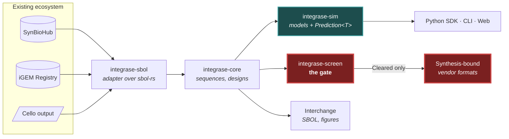

# Integrase

**Genetic design with the error bars attached.**

Integrase is an open-source platform for designing, simulating, and screening
genetic constructs, built so that every prediction arrives with the uncertainty
that belongs to it.

It reads and writes SBOL, so designs already in SynBioHub, Cello, or iBioSim come
in without conversion work. It predicts promoter and ribosome binding site
behaviour using published biophysical models, and reports what those models
actually know: a prediction, a calibrated interval, and an explicit marker when a
sequence falls outside the range where the model was validated. Every construct
is screened against biosecurity criteria before it can be exported toward
physical synthesis.

Integrase does not edit genomes, does not touch living organisms, and does not
order DNA. It operates on sequence data. Physical synthesis and wet-lab work
happen elsewhere, by people, with the oversight that entails.

---

## Project status: early

**This is honest rather than modest.** The planning is thorough and the
implementation has just started.

| | |
|---|---|
| **Works today** | SBOL 3 import and export, a thermodynamic RBS model that reports its own uncertainty, conformal calibration, motif and restriction-site search, and a Python SDK. Tests pass on Linux, macOS, and Windows. |
| **Not built yet** | Calibration against real data (needs `R-005`). Circuit compilation. Rendering. The screening backend. |
| **Version** | `0.0.0`. Nothing is published to crates.io or PyPI. |

If you are looking for a tool to use today, this is not yet that. If you are
interested in how it is being built, [`planning/`](planning/) contains 32
subplans, an architecture document, and a written record of every decision
including the ones that turned out wrong.

---

## Why this exists

The synthetic biology tooling ecosystem is real and largely dormant. Cello, which
compiles logic specifications into genetic circuits, has 875 stars and has not
been updated since 2022. SBOLDesigner has been dead since 2021. The tools that
survive are narrow: SynBioHub stores designs, pySBOL3 parses them, iBioSim
simulates them. Moving between them is manual.

Integrase is a layer that connects them, plus two things none of them do.

### 1. No prediction without its uncertainty

Published accuracy for ribosome binding site strength prediction ranges from
R² above 0.8 down to below 0.2 depending on which dataset you test on. That
spread is the honest characterisation of the field, and no existing tool reports
it. They hand you a number.

In Integrase, a predicted quantity is a `Prediction<T>`, which carries the value,
a calibrated interval, the model that produced it, and a verdict on whether your
input resembles anything that model was validated against. There is no API that
returns a bare number, in any of the three languages. That is enforced by the
type system rather than by convention.

```python
pred.value          # 4200.0
pred.interval       # Interval(lower=1900.0, upper=9100.0)
pred.coverage       # 0.80
pred.domain         # is the model guessing?
float(pred)         # TypeError, deliberately
```

That last line is the point. The one-liner that silently discards uncertainty is
`float(predict(design))`, and refusing it costs three seconds once.

**What the intervals do not cover:** genomic context, host physiology, growth
conditions, and copy number are invisible to any sequence-only model. Our
intervals describe uncertainty about the model's prediction, not about what will
happen in a cell. See [`docs/limitations.md`](docs/limitations.md).

### 2. Screening is structural, not a disclaimer

A design cannot reach a synthesis-bound export without passing biosecurity
screening. `Cleared<T>` is constructible only inside the screening crate, and
export functions accept nothing else, so bypassing the gate does not compile.

Screening delegates to [SecureDNA](https://securedna.org), which is peer-reviewed,
free, and runs on your own machine using a protocol where the client never holds
the hazard database and the database never sees your sequences. We do not
implement matching logic ourselves: a false negative is the worst failure this
system can produce.

**The sandbox stays open.** Designing, simulating, inspecting, and interchange
export are never gated. Only the path toward physical synthesis is.

**Integrase is not a biosecurity control.** It is a design tool with a screening
gate. The real control is the synthesis provider's own screening. Ours is defence
in depth: it prevents accidents, catches the uninformed, and creates an audit
trail. It does not stop a determined, knowledgeable adversary, and
[`SECURITY.md`](SECURITY.md) names two attacks it cannot prevent.

---

## Architecture



Note that `Synthesis-bound` has exactly one inbound edge and it comes from the
gate. Interchange leaves directly, because a design that came from the ecosystem
returns to it.

The full diagram set, down to module level, is in
[`planning/ARCHITECTURE.md`](planning/ARCHITECTURE.md).

---

## Quickstart

These instructions work today. They will build the workspace and run the tests;
they will not yet do anything biologically useful, because the models are not
written.

**Prerequisites:** Rust (stable), Python 3.11+, [`uv`](https://docs.astral.sh/uv/),
and [`just`](https://github.com/casey/just).

```bash
git clone https://github.com/SakarZaidan/integrase
cd integrase
just setup
just check
```

`just check` runs formatting, clippy at `-D warnings`, the Rust and Python test
suites, doctests, the prose style checker, and the diagram validator. It is
exactly what CI runs.

```bash
# What this tool does and does not do, from the terminal
cargo run -p integrase-cli -- scope
```

---

## Repository layout

```
crates/            Rust workspace
  integrase          umbrella: the stable API surface
  integrase-core     sequences, designs, indexing
  integrase-sbol     SBOL interop (adapter over sbol-rs)
  integrase-sim      biophysical models and Prediction<T>
  integrase-screen   the biosafety gateway
  integrase-logic    circuit compilation
  integrase-vdr      verifiable design records
  integrase-viz      SBOL Visual glyphs and confidence encoding
  integrase-cli      command-line interface
python/            Python SDK
proto/             gRPC contracts (written now, served in Phase 3)
planning/          decisions, and why
docs/              what the system is
tools/             repository checkers
```

---

## Standing on other people's work

Integrase depends on, rather than reimplements:

- **[`sbol-rs`](https://github.com/SynBioDex/sbol-rs)** from SynBioDex, the SBOL
  standards body. 348 machine-checkable validation rules across SBOL 3.1.0 and
  2.3.0. We verified 33 of 33 pySBOL3 cross-implementation fixtures round-trip
  losslessly before adopting it.
- **[SecureDNA](https://securedna.org)** for biosecurity screening.
- **[rust-bio](https://github.com/rust-bio/rust-bio)** for sequence indexing.

Reimplementing any of these would mean owning their correctness incompletely.

---

## Contributing

Read [`CONTRIBUTING.md`](CONTRIBUTING.md). It front-loads two rules you cannot
infer from the code and that will reject an otherwise good pull request.

Note that the **prose style in this repository is enforced in CI**, which
surprises people. A project whose thesis is that it will not overstate what it
knows cannot afford prose that overstates by habit.

- [`CODE_OF_CONDUCT.md`](CODE_OF_CONDUCT.md), including a dual-use clause
  specific to this project
- [`SECURITY.md`](SECURITY.md), including one class of vulnerability handled
  differently from standard disclosure

---

## Licence

[Apache-2.0](LICENSE). Chosen for the express patent grant, which matters in a
field as patent-dense as synthetic biology, and because it matches `sbol-rs`
upstream. See [`planning/subplans/01-project-identity-and-naming.md`](planning/subplans/01-project-identity-and-naming.md)
for the comparison against MIT and AGPL.
