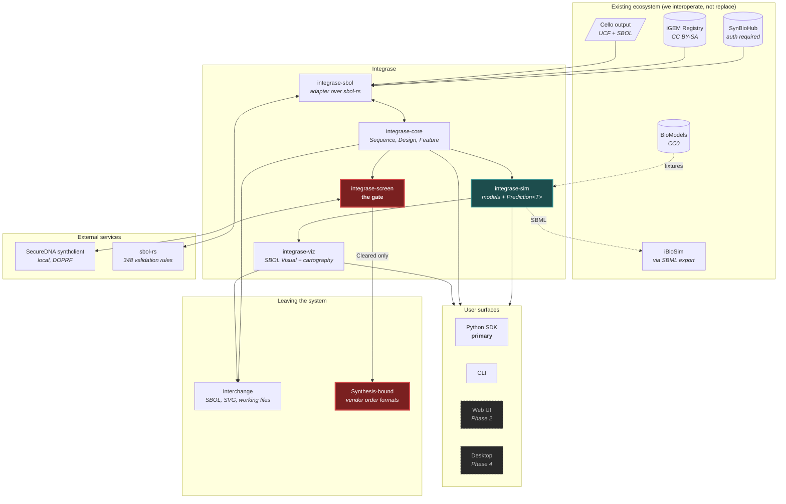
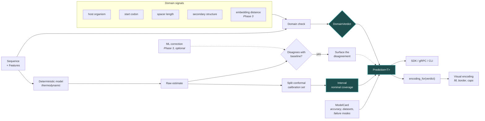
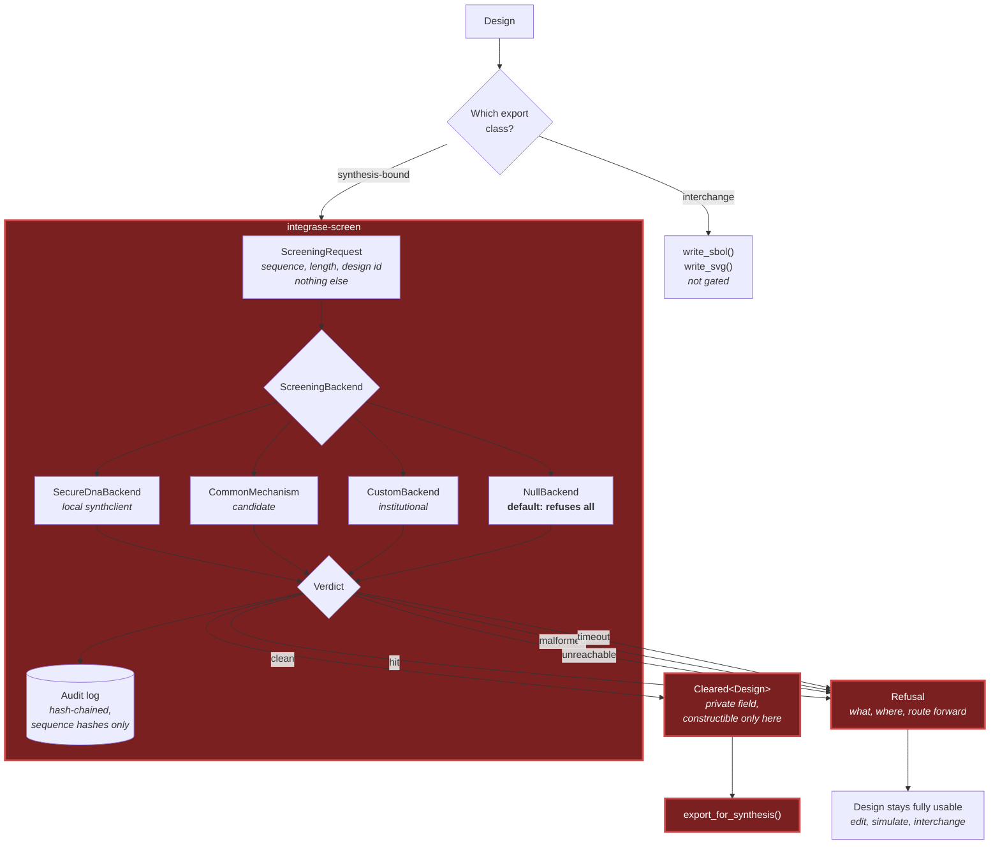
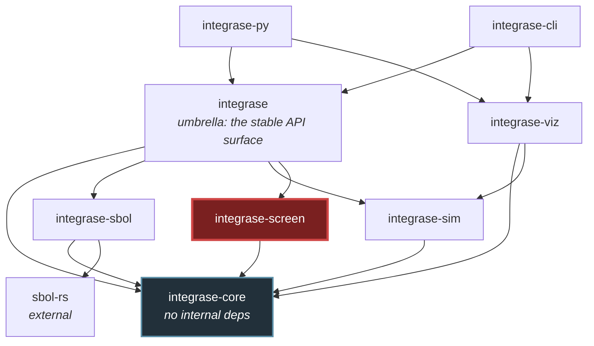
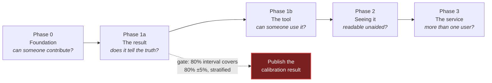

# Architecture

**Date:** 2026-09-14
**Status:** authoritative. Synthesises subplans 05, 06, 12, 13, 15, 16, and the calls made in
`FINAL-DECISION.md`.
**Audience:** two. A senior engineer who needs to understand the system's shape in one read, and a
synthetic biologist who needs to judge whether it is trustworthy. The second audience is why the
sections on uncertainty and screening carry as much weight as the module breakdowns.

---

## 1. What the system is

Integrase reads genetic designs, predicts how they will behave, reports how much to trust those
predictions, and refuses to help you order anything that fails biosecurity screening.

Three properties distinguish it structurally from every other tool in the field, and each is
enforced by the type system rather than by convention:

1. **No predicted value exists without its uncertainty.** `Prediction<T>` carries the value, its
   interval, the model that produced it, and a verdict on whether the input was inside that model's
   validated range. There is no API returning a bare number.
2. **No design reaches a synthesis-bound export without screening.** `Cleared<T>` is constructible
   only inside the screening crate, and synthesis-bound export functions accept nothing else.
3. **Confidence rendering is computed, never authored.** A single function maps a domain verdict to
   a visual encoding, so a speculative result cannot be drawn as a validated one.

What it explicitly is not: it does not edit genomes, does not interact with living organisms, does
not order DNA, and does not predict what will happen in a cell. It predicts what published
biophysical models say about a sequence, and reports how much those models know.

---

## 2. System context



**Read the two edges into `exits`.** Interchange leaves directly, because a design that came from
the ecosystem returns to it and we are not the synthesis boundary there. Synthesis-bound has exactly
one inbound edge, from the gate, and there is no path around it. That is the architecture's central
claim, and it is visible rather than asserted.

---

## 3. The confidence pipeline

The mechanism behind property 1. This is the part a biologist should read most carefully, because it
is where the trustworthiness claim either holds or does not.



### Why the interval and the verdict are separate fields

This is the single most important design decision in the system and the easiest one to get wrong.

Split conformal prediction gives a **finite-sample coverage guarantee under exchangeability** between
the calibration set and the test point. Out-of-distribution inputs are precisely where
exchangeability fails, so the guarantee evaporates exactly where a user most needs it.

Collapsing the two into one widened interval would hide that. So:

| Field | Answers |
|---|---|
| `interval` | Given that this input resembles my calibration data, how wrong am I likely to be? |
| `domain` | Does this input resemble my calibration data at all? |

A wide interval on an in-distribution input means the model is honestly uncertain. A narrow interval
on an out-of-distribution input means the interval is not trustworthy. **Those are different
situations and a single number cannot express both.**

### What the intervals do not cover

Stated here rather than only in the docs, because an architecture document that omits it is
misleading a reader who is deciding whether to trust the system.

Genomic context, supercoiling, host physiology, growth conditions, plasmid copy number, and
metabolic burden are real, substantial, and invisible to any sequence-only model. **The intervals
quantify uncertainty about the model's own prediction, not about what will happen in a cell.** No
interval computed from sequence can fix that, and the system does not claim otherwise.

---

## 4. The screening gateway

The mechanism behind property 2.



**Every uncertain outcome resolves to refusal.** Unreachable, malformed, timed out, and panicked all
converge on the same edge. There is no code path where "could not determine" becomes "allowed", and
subplan 17 tests this by fault injection rather than inspection, because it is exactly the property
that rots silently.

### Why we delegate rather than implement

A false negative in screening is the worst failure this system can produce. SecureDNA is
peer-reviewed, free, MIT/Apache-2.0, and runs on the client's own premises using a distributed
oblivious pseudo-random function, so **the client never holds the hazard database and the database
never sees plaintext sequences.** That is why the curated data is not downloadable, and the protocol
dissolves the tension rather than working around it.

Writing our own matcher would mean inventing a false-negative source to solve a problem someone else
has already solved correctly.

### The three places the guarantee weakens

`Cleared<T>` is a compile-time guarantee in Rust. It cannot cross every boundary, and where it
cannot, the degradation is documented and separately tested.

| Boundary | Enforcement | Test |
|---|---|---|
| Rust | Compile-time. `Cleared` has a private field. | `trybuild` compile-fail test |
| Python | Runtime check. Python cannot express "constructible only there". | Export an unscreened design, assert it raises |
| gRPC | Server-side. A signed `cleared_token` bound to a design hash, with expiry. | Missing, forged, stale, and mismatched tokens all refused |

**This list is not allowed to grow silently.** A fourth boundary means a fourth test, decided
deliberately.

---

## 5. Crate structure



Two structural constraints, both load-bearing:

**`integrase-core` depends on nothing internal.** That keeps it reusable and keeps its compile and
test times low. If something in `core` needs `sim`, the design is wrong and the thing belongs in
`sim`.

**`integrase-screen` depends only on `integrase-core`.** Not on `sim`, not on `sbol`. The
highest-consequence component in the system stays auditable in isolation: a reviewer can read that
crate and its one dependency and see everything affecting a verdict. Every dependency added there
widens the audit surface, and it is also the most attractive target for a supply-chain attack.

Screening being its own crate rather than a module is what makes "does this PR touch screening?"
answerable from the diff path alone, which the `pr-review` and `merge-decision` skills rely on.

---

## 6. Core data model

```rust
pub struct Sequence { data: Vec<u8>, alphabet: Alphabet }

/// Borrowed, strand-aware. Reverse-complement is a view, not a copy, because
/// the memory budget does not permit casual cloning.
pub struct SequenceView<'a> { data: &'a [u8], strand: Strand, alphabet: Alphabet }

pub struct Design { id: DesignId, sequence: Sequence,
                    features: Vec<Feature>, provenance: Provenance }

pub struct Feature { id: FeatureId, location: Location,
                     role: OntologyTerm,       // an IRI, deliberately not an enum
                     name: Option<String>, children: Vec<FeatureId> }
```

**`role` is an ontology IRI, not an enum.** The Sequence Ontology has thousands of terms, gains
more, and is maintained by people who are not us. An enum forces a breaking change every time
biology adds a category and an `Other(String)` escape hatch that becomes the most-used variant. IRIs
also round-trip through SBOL without translation.

**Coordinates are 0-based half-open, internally, everywhere.** GenBank is 1-based inclusive, BED is
0-based half-open, and SBOL has its own rules. Mixed conventions are the endemic off-by-one source
in bioinformatics, and the only defence is stating the convention once and converting at every
adapter, with tests on the conversion.

---

## 7. Measured limits

An architecture document that omits its own operating envelope is not describing a real system.
These numbers were measured on a 20-core, 7 GB WSL2 machine (subplan 09).

| Property | Measured | Consequence |
|---|---|---|
| FM-index search, 20 bp | ~120 ns, flat across a 20× index size increase | Search is not a bottleneck |
| FM-index memory | **39.4 bytes per base** | The binding constraint |
| *E. coli*, 4.6 Mbp | 0.2 GB | Comfortable |
| *D. melanogaster*, 144 Mbp | 5.3 GB | At the edge |
| Human, 3.1 Gbp | **113.8 GB** | **Out of scope** |

**Supported range is bacterial genome scale, targeting 100 Mbp.** Anything larger returns an error
naming the projection and the limit, checked before allocation, because an out-of-memory kill is not
an error message. Streaming operations that need no index still work above the limit.

This killed a feature the brief asked for. It was killed by a measurement rather than an argument,
which is the standard this project holds itself to.

---

## 8. Phase map



| Phase | Contains |
|---|---|
| 0 | Repo config, CI, scaffold, skills, `just` targets, README |
| 1a | `core`, `sbol` import, `sim` with `Prediction<T>` and the RBS model, conformal calibration, Python SDK, evaluation harness |
| 1b | CLI, `screen` with the gate and SecureDNA backend, SVG output, SBOL export, docs |
| 2 | Glyph rendering, confidence cartography, web UI, promoter model |
| 3 | Go orchestration, gRPC serving the Phase 1 contracts unchanged, Python ML service, PostgreSQL, auth |

The `proto/` contracts are written in **Phase 1** and validated against a stub server, even though
nothing serves them until Phase 3. If they need changing in Phase 3, Phase 1's semantic model was
wrong, and that is worth finding out early rather than late.

---

## 9. Why a biologist should trust this

The technical audience has section 5 and 6. This section is for the other one.

1. **It tells you when it does not know.** Every prediction carries an interval and an explicit
   verdict on whether your sequence resembles anything the model was validated on. No other tool in
   this field does this.
2. **Its accuracy claims come from the code that makes them.** `ModelCard` is a machine-readable
   structure containing published accuracy, validation datasets, and known failure modes, and the
   documentation is generated from it. The docs cannot drift from the model.
3. **Its limitations are written down.** `limitations.md` ships with the first release, listing what
   the tool cannot do, including that its intervals describe model uncertainty rather than
   biological outcome.
4. **It does not pretend to be a biosecurity control.** It is a design tool with a screening gate.
   The real control is the synthesis provider's screening. The threat model says so, including two
   attacks it cannot prevent.
5. **It does not report you.** A screening hit is explained, logged locally, and transmitted to
   nobody. The likely case is a researcher who did not know a component was regulated, and the route
   forward named is an institutional biosafety officer.
6. **It does not claim to make you compliant.** No government mandates synthesis screening; the
   mechanism is procurement conditionality and voluntary industry standards. Integrase implements
   screening consistent with the framework's approach, which is a different and smaller claim.

---

## 10. Where to read more

| Question | Document |
|---|---|
| Why these subsystem boundaries? | `subplans/06-subsystem-architecture.md` |
| Why these crates and languages? | `subplans/05-technology-stack.md` |
| Why depend on `sbol-rs`? | `subplans/23-upstream-ecosystem-strategy.md` |
| How accurate are the models, really? | `subplans/16-biophysical-modeling-accuracy.md` |
| How is calibration produced and tested? | `subplans/08-ml-architecture.md` |
| Where does screening data come from? | `subplans/24-screening-data-and-operations.md` |
| What can an attacker do? | `subplans/10-security-and-threat-model.md` |
| What are the performance limits? | `subplans/09-performance-engineering.md` |
| What was decided, and what was rejected? | `FINAL-DECISION.md` |
| Is this project actually a good idea? | `subplans/03` and `subplans/22` |
