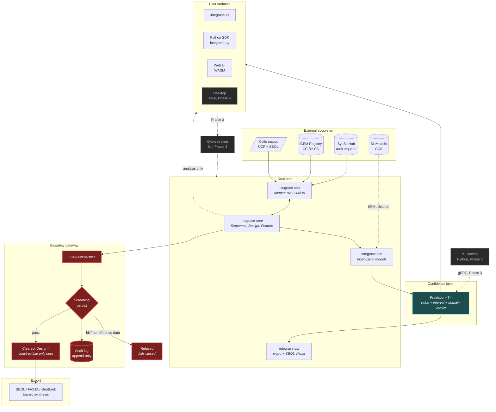

# 06. Per-subsystem architecture

**Status:** decided
**Date:** 2026-09-14
**Decides:** module structure, core data types, and the interfaces between subsystems
**Depends on:** subplans 02 (scope), 05 (stack), 23 (adopt `sbol-rs`)
**Feeds:** `ARCHITECTURE.md`, subplans 07, 09, 12, 15, 17, 24

---

## The two architectural commitments

Everything in this document follows from two decisions. Both exist to make the project's
differentiators **structural rather than documented**, because a principle enforced only by
convention is a principle that erodes on a deadline.

1. **No prediction can be obtained as a bare number.** The type that carries a predicted value also
   carries its interval, its model identity, and a verdict about whether the input was inside the
   range where that model was validated. There is no API that returns `f64` for a predicted
   quantity. Getting the number out requires acknowledging what is attached to it.

2. **No design can reach an export path without passing the screening gateway.** This is enforced
   by the type system, not by a code review checklist. Export functions accept only a type that the
   screening module alone can construct.

If either of these is ever weakened for convenience, the project has lost the thing that
distinguishes it. Subplan 07 makes both non-negotiable, and the `pr-review` skill checks for
attempts to route around them.

---

## System data flow



Two things the diagram is meant to make unmissable. Every arrow reaching `Export` passes through
the gateway, and there is no bypass edge. And `Prediction<T>` sits between every model and every
surface, so nothing reaches a user without its uncertainty.

The dotted `CORE -.analysis only.-> surfaces` edge is deliberate: designing, simulating, and
inspecting inside the sandbox is never gated. Only the path toward physical synthesis is.

---

## `integrase-core`: sequences and designs

The substrate. No biology models, no I/O formats, no rendering.

```
integrase-core/
├── seq/
│   ├── alphabet.rs      Dna, Rna, Protein, ambiguity codes
│   ├── sequence.rs      Sequence, SequenceRef, owned vs borrowed
│   ├── view.rs          Strand-aware windows without copying
│   └── edit.rs          insert, delete, replace, with coordinate remapping
├── design/
│   ├── design.rs        Design: the top-level construct
│   ├── feature.rs       Feature: a located, role-annotated region
│   ├── location.rs      Location, Strand, coordinate arithmetic
│   └── hierarchy.rs     subcomponent composition
├── index/
│   ├── fm.rs            FM-index wrapper over `bio`
│   ├── motif.rs         IUPAC motif search
│   └── restriction.rs   restriction site detection
└── provenance.rs        Provenance, shared with the confidence layer
```

### Core types

```rust
/// Nucleotide data. Stored as bytes, not chars: a genome is not a String.
pub struct Sequence {
    data: Vec<u8>,
    alphabet: Alphabet,
}

/// A borrowed, strand-aware window. Reverse-complement is a view, not a copy,
/// which matters because the 7 GB memory budget does not permit casual cloning.
pub struct SequenceView<'a> {
    data: &'a [u8],
    strand: Strand,
    alphabet: Alphabet,
}

/// A construct. Features are ordered and may nest.
pub struct Design {
    id: DesignId,
    sequence: Sequence,
    features: Vec<Feature>,
    provenance: Provenance,
}

/// A located, role-annotated region. `role` is a Sequence Ontology term,
/// carried as an ontology IRI rather than an enum, because the SO is large,
/// evolving, and not ours to enumerate.
pub struct Feature {
    id: FeatureId,
    location: Location,
    role: OntologyTerm,
    name: Option<String>,
    children: Vec<FeatureId>,
}
```

**Design note on `role: OntologyTerm` rather than `enum Role { Promoter, Rbs, Cds, ... }`.** An enum
would be more ergonomic and would be wrong. The Sequence Ontology has thousands of terms, gains
more, and is maintained by people who are not us. An enum forces a breaking change every time
biology adds a category, and forces an `Other(String)` escape hatch that immediately becomes the
most-used variant. Ontology IRIs also round-trip through SBOL without translation. Convenience
constructors (`Feature::promoter(...)`) give the ergonomics back for the common cases without
constraining the model.

**Memory posture.** The 7 GB constraint from the research log shapes this module more than any
other. `SequenceView` exists so that reverse-complementing, windowing, and sub-slicing allocate
nothing. Large-sequence ingest is streaming and memory-mapped rather than read-to-string. Subplan
09 sets the budget as a testable number.

---

## `integrase-sbol`: the adapter

Thin, by decision from subplan 23. This crate does **not** implement SBOL. It translates between
`sbol-rs` types and `integrase-core` types, and it carries the metadata SBOL has no place for.

```
integrase-sbol/
├── import.rs      sbol-rs Document -> Design
├── export.rs      Design -> sbol-rs Document
├── roundtrip.rs   semantic comparison, NOT triple comparison
└── report.rs      surface Upgrade/DowngradeReport to users
```

Two points earned in subplan 23 by measurement.

**`roundtrip.rs` compares semantically, never on triples.** SBOL 2 to 3 conversion canonicalizes
ontology URIs and cannot preserve `persistentIdentity`/`version`, which SBOL 3 removed. A test
asserting triple equality fails on correct behaviour, and the usual outcome is that someone weakens
it until it passes.

**`report.rs` exists because `sbol-rs` returns `UpgradeReport` and `DowngradeReport` alongside
converted documents.** The library tells you what it changed. Discarding that would be
inconsistent with a project whose whole thesis is not hiding what it knows. Conversion reports are
user-facing data.

---

## `integrase-sim`: biophysical models and the confidence layer

Where commitment 1 lives.

```
integrase-sim/
├── confidence/
│   ├── prediction.rs    Prediction<T>, the central type
│   ├── interval.rs      Interval<T>, coverage semantics
│   ├── domain.rs        DomainVerdict, in/marginal/out of distribution
│   └── calibration.rs   calibration measurement, used by tests
├── rbs/
│   ├── thermodynamic.rs Salis-style free-energy model
│   └── features.rs      SD/aSD hybridization, spacing, secondary structure
├── promoter/
│   ├── thermodynamic.rs -35/-10 box, spacer scoring
│   └── motif.rs         sigma factor motif matching
└── model.rs             Model trait, ModelId, ModelCard
```

### The central type

```rust
/// A predicted quantity. There is no API in this crate that returns a bare
/// value for a predicted quantity. This is the product principle expressed as
/// a type, and weakening it weakens the product.
pub struct Prediction<T> {
    value: T,
    interval: Option<Interval<T>>,
    /// Nominal coverage of `interval`, e.g. 0.80. Meaningless without the
    /// calibration evidence in the model card.
    nominal_coverage: f64,
    model: ModelId,
    domain: DomainVerdict,
    provenance: Provenance,
}

/// Confidence cartography, made concrete. This is the field that decides how
/// a value is rendered: well-validated elements look different from
/// speculative ones, and that difference is computed, not authored.
pub enum DomainVerdict {
    /// Input resembles the model's validation set on stated criteria.
    InDistribution { similarity: f64 },
    /// Input is at the edge. Intervals are reported but widened.
    Marginal { similarity: f64, reason: DomainReason },
    /// Outside anything this model was validated on. A value may still be
    /// produced; it should be rendered as unvalidated and must not be
    /// presented as a measurement.
    OutOfDistribution { reason: DomainReason },
    /// The model has no calibration evidence at all. Honest default for any
    /// model that has not been through subplan 08's evaluation.
    Uncalibrated,
}
```

`Uncalibrated` is the default for a new model rather than an error. That is deliberate. It means a
contributor can add a model without first producing calibration data, and the system will report
honestly that the model is uncalibrated rather than either refusing to run it or silently implying
confidence it has not earned.

```rust
pub trait Model {
    type Input;
    type Output;
    fn id(&self) -> ModelId;
    fn card(&self) -> &ModelCard;
    fn predict(&self, input: &Self::Input) -> Prediction<Self::Output>;
    /// How this model decides whether an input is in its validated domain.
    fn domain_check(&self, input: &Self::Input) -> DomainVerdict;
}

/// Published accuracy, validation datasets, known failure modes, and the
/// calibration evidence behind `nominal_coverage`. Machine-readable, surfaced
/// in the UI, and required for a model to be anything but `Uncalibrated`.
pub struct ModelCard { /* ... */ }
```

The `ModelCard` being a required, machine-readable part of a model rather than a docs page is the
mechanism that stops accuracy claims drifting from evidence. Subplan 16 owns the content;
subplan 08 owns how calibration is measured; subplan 17 owns testing that stated coverage is real.

### Honest note on the models themselves

The deterministic baselines are published methods with known, wide error bounds: thermodynamic RBS
prediction ranges from R² > 0.8 to R² < 0.2 depending on dataset (research log 4.2). This
architecture does not improve those models. It makes their uncertainty impossible to ignore, which
is a different and more achievable goal. Subplan 16 is the honest deep-dive.

---

## `integrase-screen`: the biosafety gateway

Where commitment 2 lives. Its own crate, deliberately, so the boundary is structural and so a diff
touching it is detectable by path alone.

```
integrase-screen/
├── gateway.rs      ScreeningGateway trait, Cleared<T>
├── verdict.rs      ScreeningVerdict, HitClass, Confidence
├── backend/
│   ├── mod.rs      ScreeningBackend trait
│   ├── external.rs delegate to SecureDNA / Common Mechanism
│   └── null.rs     NullBackend: no reference data, refuses everything
├── policy.rs       thresholds, versioned and hot-swappable
└── audit.rs        append-only audit trail
```

### The type-level gate

```rust
/// A design that has passed screening. The inner field is private to this
/// crate, so `Cleared` cannot be constructed anywhere else. Export functions
/// accept only this type, which makes "nothing reaches export without
/// screening" a compile-time property rather than a review checklist item.
pub struct Cleared<T> {
    inner: T,
    verdict: ScreeningVerdict,
    screened_at: Timestamp,
    policy_version: PolicyVersion,
}

impl<T> Cleared<T> {
    pub fn verdict(&self) -> &ScreeningVerdict { &self.verdict }
    pub fn into_inner(self) -> T { self.inner }
}

pub trait ScreeningGateway {
    /// The only constructor of `Cleared` anywhere in the system.
    fn screen<T: Screenable>(&self, item: T) -> Result<Cleared<T>, Refusal>;
}
```

An export function therefore reads:

```rust
// Cannot be called with an unscreened Design. Will not compile.
pub fn export_for_synthesis(design: &Cleared<Design>, fmt: VendorFormat, w: impl Write)
    -> Result<(), ExportError>;
```

This is the concrete answer to the brief's requirement that it be obvious nothing reaches export
without passing the gateway. It is obvious because the alternative does not compile.

### Two export classes (amended 2026-09-14 by subplan 21)

Sequencing the work in subplan 21 exposed a gap here. Taken literally, "export requires `Cleared`"
plus "`NullBackend` refuses everything" means an unconfigured user cannot even save their own design
back to SBOL, which would make the tool useless and over-applies the brief. The brief restricts
"only at the boundary where a design would leave the system toward physical synthesis."

| Class | Examples | Gated |
|---|---|---|
| **Interchange** | SBOL round-trip, saving a working file, sharing with a collaborator, SVG figures | **No.** The design came from the ecosystem and returns to it. |
| **Synthesis-bound** | The explicit "prepare for ordering" flow, vendor order sheets, FASTA or GenBank produced by it | **Yes.** `Cleared<T>` required. |

**The distinction is the flow, not the file format.** The same FASTA bytes are interchange when a
user saves a working file and synthesis-bound when produced by the ordering path. So the gate lives
on the function, not on the serializer:

```rust
// Interchange. Not gated.
pub fn write_sbol(design: &Design, w: impl Write) -> Result<(), ExportError>;

// Synthesis-bound. Cannot be called with an unscreened design.
pub fn export_for_synthesis(design: &Cleared<Design>, fmt: VendorFormat, w: impl Write)
    -> Result<(), ExportError>;
```

Partly a loophole, and subplan 10's evasion table already records the honest version: a user who
copies a sequence out of the interface by hand defeats any gate. Gating interchange would not close
that and would only make the tool worse for the researchers who are the overwhelming majority. The
gate's value is that **the convenient path to ordering passes through screening**, not that every
byte is imprisoned.

### Fail closed, and say so

`NullBackend` is the default when no screening backend is configured, and it **refuses everything on
the synthesis-bound path**. This follows directly from `REQUESTS.md` R-002: the curated sequence-of-concern data
is not publicly obtainable, so the common case for a new user is having no reference data at all.

Three possible behaviours, and only one is honest:

| Behaviour | Verdict |
|---|---|
| Pass everything when unconfigured | Silently unsafe. Users would believe they were screened. Rejected. |
| Ship a toy dataset | Worse. Implies real screening exists. Rejected explicitly in subplan 04. |
| **Refuse, and state why** | The design stays fully usable for analysis, simulation, and interchange export. Only the synthesis-bound path is closed, with a message saying no screening backend is configured and how to configure one. |

The sandbox stays open. Design, simulate, inspect, iterate: none of that is gated, ever. Only the
boundary toward physical synthesis is.

### Policy versioning is a hard requirement, not a nicety

From research log section 3: the OSTP framework threshold drops to 50 bp and the
sequence-of-concern definition expands in October 2026, with IGSC conformance due 2026-10-24. The
rules change on a known cadence. Thresholds and reference data are therefore **versioned,
hot-swappable configuration**, never compiled-in constants, and every verdict records the
`policy_version` that produced it so an audit can reconstruct why a past decision was made.

Subplan 24 owns data sourcing, operational policy, and disclosure. Subplan 10 owns the threat
model. They cross-reference each other and this section.

---

## `integrase-viz`: rendering

```
integrase-viz/
├── glyph/
│   ├── ontology.rs   SBOL Visual glyph selection by ontology lookup
│   ├── geometry.rs   glyph path geometry
│   └── layout.rs     linear construct layout
├── confidence/
│   └── cartography.rs  how DomainVerdict becomes visual encoding
└── backend/
    ├── wgpu.rs
    └── svg.rs        deterministic vector output for docs and papers
```

**Glyph selection is an ontology lookup, not a match statement.** The SBOL Visual ontology provides
machine-readable glyph constraints, so a feature's SO term resolves to a glyph through data. A
`match` over role terms would drift from the spec the first time the SO adds a term.

**`svg.rs` is not a fallback, it is a deliverable.** Scientists put figures in papers. A
deterministic, text-diffable SVG path also makes visual regression testing possible, which a GPU
path does not.

**Confidence cartography** is the visual encoding of `DomainVerdict`. Subplan 13 and 14 own what it
looks like. The architectural requirement is only that the encoding is computed from the verdict
rather than authored per-diagram, so it cannot silently disagree with the model.

**Rejected: 3D construct rendering.** The brief asks for it. Genetic constructs are linear
sequences, and SBOL Visual specifies a 2D glyph language because that is what communicates. 3D would
be a demo, not a user need. Subplan 13 argues this properly.

---

## Deferred subsystems, and what we do instead

| Brief subsystem | Status | Instead |
|---|---|---|
| Circuit-logic compilation | Deferred past v1.0 | Import Cello's UCF and SBOL output. Cello did this well; it is dormant, not wrong. |
| ML-guided generative design | Phase 3 | Evo 2 is open-weight and better than anything we would train. Integrate, do not compete. |
| Genome-scale FM-index search | Built when a scenario needs it | Subplan 11 decides whether any real scenario does. |

---

## Interfaces between subsystems

| From | To | Interface | Notes |
|---|---|---|---|
| `integrase-sbol` | `integrase-core` | `Design` / `Feature` | The only translation point for external formats. |
| `integrase-core` | `integrase-sim` | `&Design`, `SequenceView` | Read-only. Simulation never mutates a design. |
| `integrase-sim` | everything | `Prediction<T>` | The only way a predicted value travels. |
| `integrase-core` | `integrase-screen` | `impl Screenable` | Screening reads sequence and features. |
| `integrase-screen` | export | `Cleared<T>` | The only path out. |
| Rust core | Go / Python services | gRPC, `proto/` | Phase 3. Contracts written in Phase 1. |

---

## Open items

- [ ] Cello UCF format specifics, needed for the import path -> research, then **11**
- [ ] Whether the audit log needs durable storage before Phase 3 -> **24**, affects **05**
- [ ] Does `bio`'s FM-index meet the targets, or do we need our own -> **09**
- [ ] Exact visual encoding for each `DomainVerdict` variant -> **13**, **14**
- [ ] `Screenable` trait surface: what exactly does a backend get to see -> **24**
